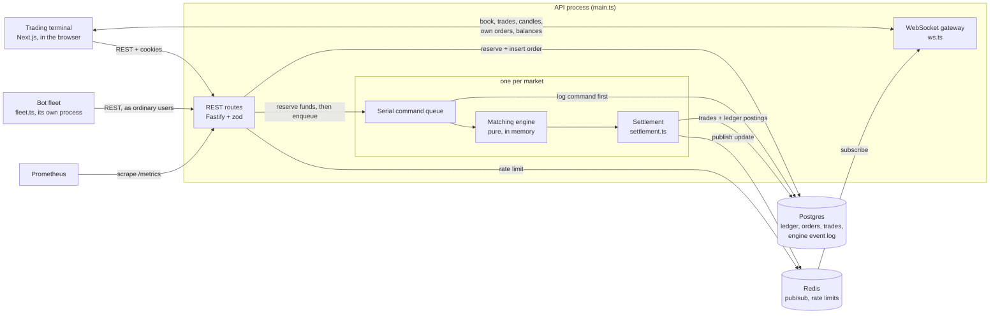

# Slipstream

A real-time centralized cryptocurrency exchange simulator: a price-time-priority matching
engine, a double-entry ledger, WebSocket market data, a trading terminal and a fleet of trading
bots that trade in the same order books as human users.

> **Simulator only.** Slipstream moves no real money and no real cryptocurrency. Deposits are
> simulated, there is no custody, no KYC and no connection to any real market, and its prices
> mean nothing. It is a portfolio project, not financial software. Do not run it as a service
> for other people's funds.

## Quick start

Needs Docker with Compose.

```sh
git clone https://github.com/vaidii2008/slipstream-exchange.git
cd slipstream-exchange
docker compose --profile app up
```

Open [http://localhost:3001](http://localhost:3001) and register an account. Eight bots, a
market maker and three noise traders per market, start quoting and trading BTC-USD and ETH-USD
as soon as the API is healthy. Prometheus is on [http://localhost:9090](http://localhost:9090).

The terminal has no deposit form yet, so fund your account through the API with the email
and password you registered:

```sh
EMAIL=you@example.com PASSWORD='your password'
TOKEN=$(curl -s localhost:3000/login -H 'content-type: application/json' \
  -d "{\"email\":\"$EMAIL\",\"password\":\"$PASSWORD\"}" | sed -E 's/.*"accessToken":"([^"]+)".*/\1/')
for deposit in '{"asset":"USD","amount":"100000"}' '{"asset":"BTC","amount":"1"}'; do
  curl -s localhost:3000/deposits -H "authorization: Bearer $TOKEN" \
    -H 'content-type: application/json' -d "$deposit"; echo
done
```

Reload the terminal to see the new balances: a deposit is not pushed over the socket, only
order activity is.

The `app` profile builds two images from this repo and runs, in order: Postgres, Redis and
Prometheus; the migrations; the API; then the bot fleet and the terminal. Ports are published
on 127.0.0.1 only. The secrets in `compose.yaml` are fixed demo values so the quick start needs
no `.env`.

**The terminal's API address is baked in at build time.** `NEXT_PUBLIC_API_URL` is read by code
that runs in the browser, so Next.js writes it into the JavaScript bundle when the image is
built, and setting it on a running container does nothing. It is a build argument of
`web/Dockerfile` (default `http://localhost:3000`). The API's `WEB_ORIGIN` must be the
terminal's address as the browser sees it (default `http://localhost:3001`), or CORS refuses
the terminal's requests. To serve it anywhere else, change both and rebuild:

```sh
docker build -f web/Dockerfile --build-arg NEXT_PUBLIC_API_URL=https://api.example.test .
```

### Running from source

Node 24 or later runs the `.ts` files directly; there is no build step for the API.

```sh
cp .env.example .env            # then set JWT_ACCESS_SECRET and BOT_PASSWORD
npm ci
docker compose up -d --wait     # Postgres, Redis and Prometheus only
npx drizzle-kit migrate
npm start                       # API on :3000
npm run bots                    # the bot fleet, in another terminal
cd web && npm ci && npm run dev # terminal on :3001
```

`npm run check` is the gate every commit passes: format, typecheck, lint, the test suite
(440 tests against real Postgres and Redis) and the terminal's typecheck, lint and build.

## Architecture



An order's path:

1. **Reserve.** `POST /orders` validates the body with zod and converts amounts to integer
   minor units in `money.ts`, the one place that converts. Then, in one Postgres transaction,
   it locks the user's accounts, moves funds from available to reserved and inserts the order.
2. **Match.** The order joins its market's serial queue. That queue is the engine's only
   writer, so the book needs no locks. The command is appended to `engine_events` before the
   engine applies it. The engine is plain TypeScript with no I/O: price levels in a sorted
   array, FIFO within a level, every event numbered by a per-market sequence.
3. **Settle.** The fills it returns are settled in a second transaction: trades inserted,
   reserved funds moved to each counterparty, order statuses updated. Every balance change is
   a double-entry ledger transaction whose entries sum to zero per asset.
4. **Publish.** The settled command goes to Redis. The gateway sends book deltas, trades,
   candles and private order and balance updates to subscribed sockets.

On boot, each market takes a Postgres advisory lock, so only one process writes it. It then
rebuilds its book by replaying the event log and finishes any settlement a crash interrupted.
It opens only if the rebuilt book matches the orders Postgres says are open.

Money is never a float. Prices and quantities are `bigint` minor units in the engine and
`NUMERIC(36,18)` in Postgres. An amount with more decimals than its asset allows is rejected,
never rounded.

## Results

Every number below was measured in this repo. **Engine-only** means `npm run bench`: the engine
in one process, no I/O. **End to end** means k6 driving the HTTP API, through the reservation,
the event log, the settlement and Redis, against a database created for the runs, with the
bots stopped.

**Machine and date:** MacBook, Apple M4 (10 cores, 16 GB), Node 24.21.0; Postgres 16 and Redis 7
in Docker Desktop (10 CPUs, 7.75 GB); k6 1.2.3 in Docker. 7 November 2026.

| Kind        | What                                                                   | Result                                                      |
| ----------- | ---------------------------------------------------------------------- | ----------------------------------------------------------- |
| Engine-only | Mixed commands on a book near 5,000 resting orders                     | 4,305,856 commands/s; p50 0.21 µs, p99 0.54 µs              |
| Engine-only | One price level near 10,000 orders                                     | 2,258,113 commands/s; cancel p99 1.54 µs                    |
| End to end  | One market, ramped until its queue saturates (near-empty ledger)       | ~264 commands/s                                             |
| End to end  | Both markets, ramped to 600/s offered, ledger of 3.6M entries          | peak 325–360/s; 269–300/s saturated                         |
| End to end  | Placement latency at a steady 200/s, both markets, 3.6M entries        | p50 7.5 ms, p95 24 ms, p99 57 ms                            |
| End to end  | The match inside a placement (200/s steady)                            | p50 4.1 µs                                                  |
| End to end  | Trade to subscriber, 200 sockets, 100 orders/s                         | p50 18 ms, p95 44 ms, p99 69 ms; no gap in 1,791,445 deltas |
| End to end  | Boot: replay the log until `/health` answers, 118,271 / 1,011,453 cmds | 0.76–1.12 s / 3.3–4.1 s                                     |

The engine is four orders of magnitude faster than the exchange around it. A market runs one
command at a time, so its ceiling is one over the time a command takes, about 3.8 ms. That time
is mostly Postgres round trips: a resting order sends 16 statements over its life, a crossing
order 43. The 4 µs match is a rounding error inside it. The trade-to-subscriber delay
compares k6's container clock with the host's, which disagree by at least 12 ms.

## Three things the measurements found

**The ledger deadlock.** A reserve and a release on the same user and asset could deadlock. Each
held `FOR UPDATE` on the account it debited. Inserting its entry needed `FOR KEY SHARE` on the
other account for the foreign-key check, and `FOR UPDATE` blocks that. With 40 interleaved
reserves and releases, **36 died with deadlock errors (40P01). With `FOR NO KEY UPDATE`, 0
did.** That lock doesn't conflict with the foreign-key check, and it still makes two writers of
one account queue. Later, the cached balance (below) meant credited accounts had to be locked
too. Locking them in posting order brought it back: **29 deadlocks in 40 opposite-direction
trades. Locking every account up front in id order: 0.** Lock order is the whole fix. Two
transactions that ask for the same rows in the same order queue instead of deadlocking.
(`lockAccounts` in `ledger.ts`.)

**The quadratic boot check.** Before a market opens, recovery checks that every order Postgres
calls open is on the rebuilt book. It did that with `resting.some(...)` for each open order:
open × resting comparisons. The kill test, with tens of orders resting, never noticed. At 1M
logged commands, with about 31,000 orders resting per market, **the check took 2.8–3.6 s of each
market's boot and launch to healthy was 9.3–10.9 s. With a set of resting ids, the check takes
0.2–0.4 s and launch to healthy is 3.3–4.1 s.** (`checkBook` in `recovery.ts`.)

**The cached balance.** A balance was the sum of an account's ledger entries, recomputed by every
reservation and settlement under the account's row lock. Filling the log to 1M commands at a
fixed offered rate, throughput fell chunk by chunk from about 250 to 123 commands/s while the
match stayed under 10 µs. The sums were growing with history. Each account now caches the sum,
updated in the same transaction as its entries, under the same lock. A test checks every
account in the database for a cached balance that differs from its entries. On fresh copies of
one database padded to 3.6M entries, at a steady 200/s: **placement p50 28.9 ms → 7.5 ms, p99
1.23 s → 57 ms; saturated throughput 179–212/s → 269–300/s.** Balance reads, which the bots make
every tick, now read the cached column too. On the same padded database, one user's read went
from 7.0–7.5 ms to 0.07–0.21 ms, a single Postgres query timed in `psql` with a warm cache.
(`postTransaction` and `accountState` in `ledger.ts`.)

## Known limits

- **Sockets share the matching event loop.** The engine, its settlements and the WebSocket
  fan-out run on one Node event loop. At 220 orders/s with 200 subscribers the process sent
  about 25,000 messages a second, event-loop lag p99 reached 89 ms, and throughput fell to
  177/s. Redis pub/sub already allows moving the gateway to its own process; it hasn't been
  done.
- **Boot replays the whole log.** There are no snapshots, so every boot reads and replays each
  market from its first command: about 3.5 s of downtime per million commands on this machine,
  growing with the log. The whole log is in memory during replay, 1.5–1.6 GB peak at 1M
  commands.
- **`/metrics` is unauthenticated.** It exposes counts and latencies per market, never user or
  order ids, but anyone who can reach the API can read it. A real deployment would serve it on
  a separate, private listener.
- **One process per market.** The advisory lock refuses a second writer, but a settlement
  already in flight when the lock drops still commits. The trades table's unique (market,
  sequence) makes a double settlement fail and halt rather than pay twice.
- **A market's ceiling is its round trips.** One command at a time means one market tops out
  at a few hundred commands a second here. Settling several queued commands per transaction is
  the lever, and it is not built.

## Where things live

The repo is flat on purpose. A module got its own file only when something forced it. The
reasons are in the commit history: each `refactor:` commit names its pressure.

| File                              | What                                                         |
| --------------------------------- | ------------------------------------------------------------ |
| `engine.ts`, `book.ts`            | The matching engine and its order book. Pure, no I/O.        |
| `exchange.ts`                     | Per-market serial queues, boot, halts.                       |
| `marketlock.ts`                   | The per-market Postgres advisory lock.                       |
| `ledger.ts`                       | Double-entry ledger, row locking, cached balances.           |
| `orders.ts`, `settlement.ts`      | Reserve-and-record, then settle fills.                       |
| `events.ts`, `recovery.ts`        | The engine event log, replay and crash recovery.             |
| `trading.ts`, `wallet.ts`         | Order and balance routes.                                    |
| `ws.ts`, `feed.ts`, `protocol.ts` | WebSocket gateway, Redis feed, the wire types.               |
| `bots.ts`, `strategies.ts`        | Bot runtime, risk limits, market maker and noise trader.     |
| `money.ts`                        | The only conversion between decimal strings and minor units. |
| `web/`                            | The trading terminal.                                        |
| `load/`                           | k6 scripts and the bench database tool.                      |
| `DECISIONS.md`                    | Every design decision, the alternative and why.              |

## License

MIT. See `LICENSE`.
